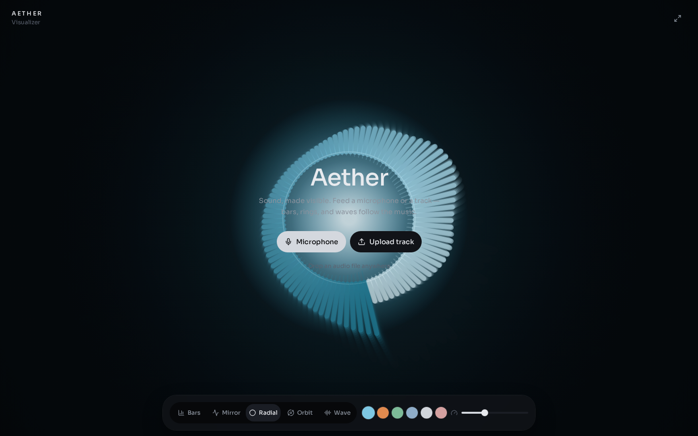

# Aether

A cinematic music visualizer. Feed a microphone or an audio file and watch bars, rings, and waves follow the sound.

**Live:** [ahmaddroobi99.github.io/aether-visualizer](https://ahmaddroobi99.github.io/aether-visualizer/)



```
Mic / file
  ↓
Web Audio analyser (frequency + time domain)
  ↓
Canvas 2D renderer
  ↓
Bars · Mirror · Radial · Orbit · Wave
```

## Features

- Microphone input or uploaded / dropped tracks
- Five modes: Bars, Mirror, Radial, Orbit, Wave
- Color themes: Ice, Ember, Moss, Bloom, Noir, Rose
- Sensitivity, play/pause, seek, volume, fullscreen
- Keyboard: Space play/pause, F fullscreen, 1–5 modes, M mute

Nothing is uploaded. Audio stays in the browser.

## Run locally

```bash
npm install
npm run dev
```

```bash
npm run build
npm run preview
```

GitHub Pages builds a static prerender (`GITHUB_PAGES=true`) so the visualizer can run without a server.

## Stack

React, TanStack Start, Tailwind CSS, Web Audio API, Canvas 2D.

## Related

- [wake](https://github.com/ahmaddroobi99/wake) — pointer-driven particle field
- [engineering-portfolio](https://github.com/ahmaddroobi99/engineering-portfolio)

---

Account grouping: research first, undergraduate last — see the [profile README](https://github.com/ahmaddroobi99/ahmaddroobi99). GitHub cannot custom-sort the Repositories tab.

